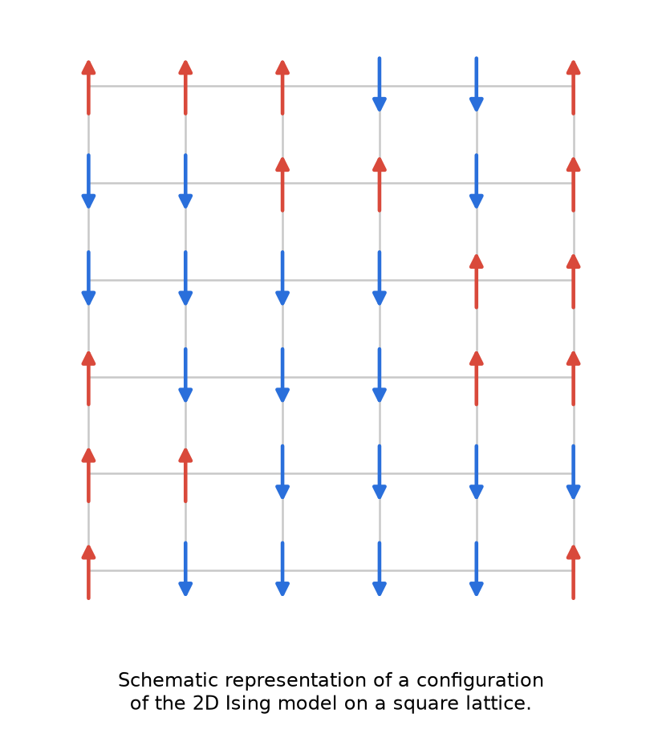
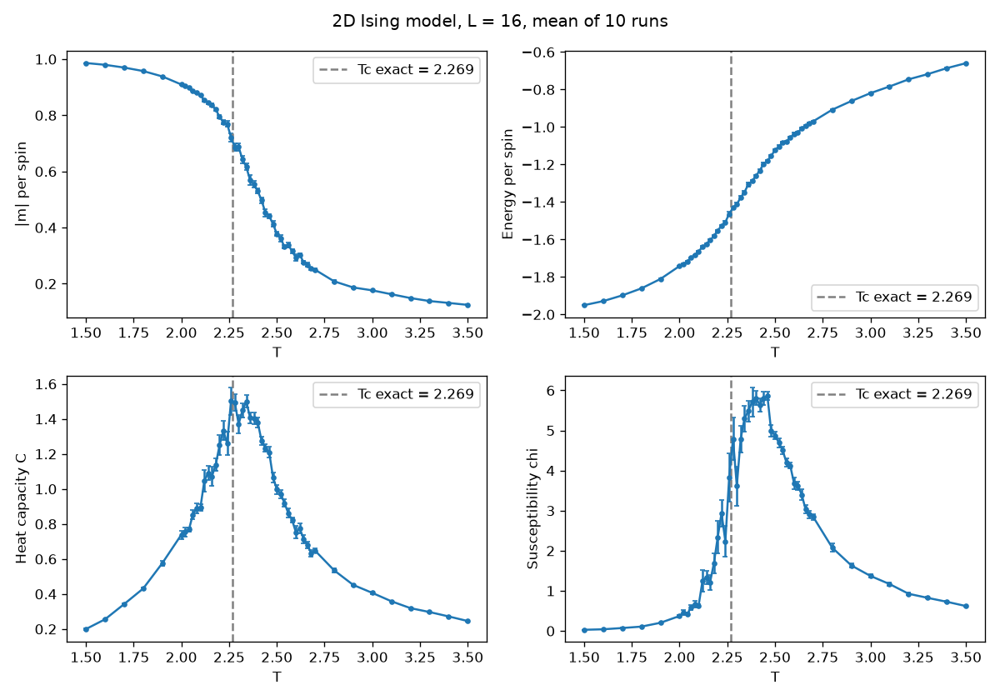
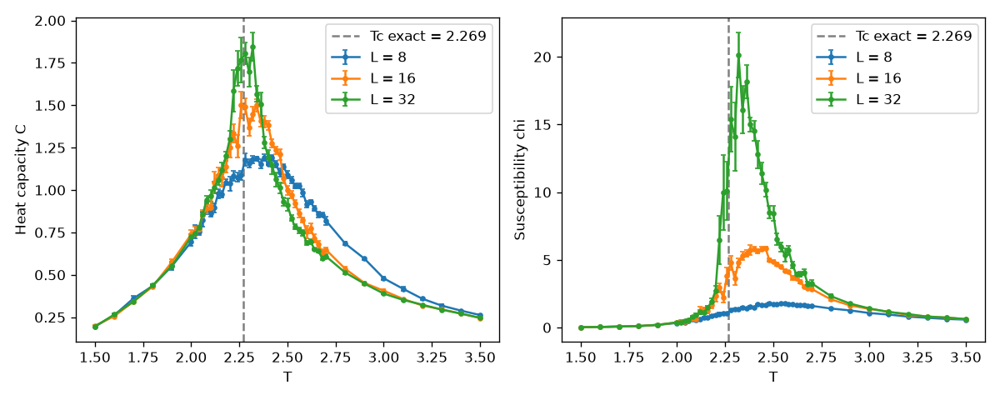
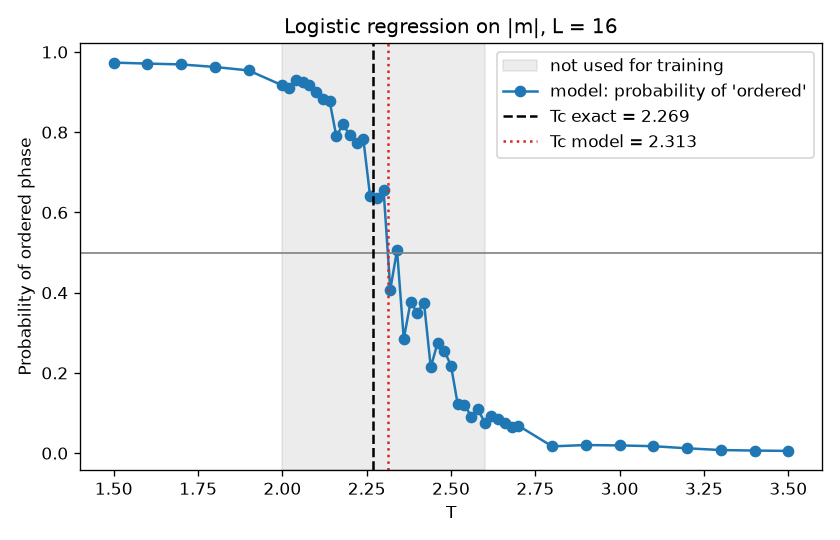
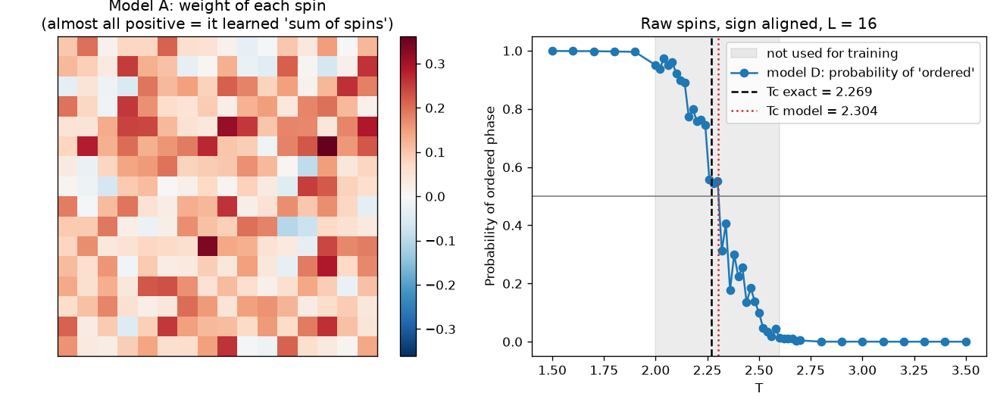

# Machine learning finds the phase transition in the 2D Ising model

A physicist's bridge project: Monte Carlo simulation (my PhD toolbox) and machine learning (scikit-learn) applied to the same problem.

**The question:** can a model find the critical temperature without being told any physics?

## The physics

The 2D Ising model is the simplest model of a magnet: spins $s_i = \pm 1$ on an $L \times L$ square lattice with periodic boundary conditions.



Without an external magnetic field, the Hamiltonian of the system is

$$H = -J \sum_{\langle i,j \rangle} s_i s_j$$

where $J > 0$ is the isotropic exchange constant, the sum runs over nearest-neighbour spin pairs, and $s_i$ is the spin at site $i$.

Below the critical temperature the spins align (ferromagnet). Above it, thermal noise wins and the spins are disordered (paramagnet). The exact answer is known (Onsager, 1944): **Tc = 2.269** (in units with J = 1, k_B = 1). This makes the model a perfect benchmark.

## What is in the project

### 1. Monte Carlo simulation (`ising_mc.py`)

Metropolis algorithm, temperature scan from hot to cold with a finer step near Tc, and 10 independent runs with different seeds for error bars. Observables: |m|, energy, heat capacity C and susceptibility χ. Tc is located from the peaks of C and χ.



### 2. Finite-size check (`plot_sizes.py`)

The same scan for L = 8, 16 and 32. The susceptibility peak grows with L and moves toward the exact Tc (2.48 → 2.46 → 2.32), as expected for a true phase transition.



### 3. Machine learning (`ml_level1.py`)

Logistic regression trained on 4,900 lattice snapshots labelled "ordered" or "disordered", with a train/test split and balanced class weights. The model is trained **only far from the transition** (T < 2.0 and T > 2.6), then asked about all temperatures. The temperature where its predicted probability crosses 50% is the model's estimate of Tc: it reconstructs the transition in a region it has never seen.



### 4. Raw spins and the symmetry trap (`ml_level2.py`)

Now the model gets no hint: instead of |m| it sees all 256 raw spins of each snapshot. The script tells the story in four steps:

| Step | What I did | Test accuracy |
|---|---|---|
| A | Logistic regression on raw spins | 99.7% |
| B | Same cold snapshots with **all spins flipped** (physically the same ordered state) | **0%** |
| C | Honest data: every snapshot plus its flipped copy | 72.2%, equal to always answering "disordered" |
| D | Fix: flip each snapshot so that its magnetisation is positive | 99.4%, Tc = 2.304 |

**What went wrong.** While cooling, my simulation happened to settle into the "spin up" state, so every ordered snapshot in the data had m ≈ +1. The model learned "many up spins means ordered" (left plot: almost all weights are positive, so it simply sums the spins). That rule matches the data but not the physics: flipping every spin does not change the energy (Z2 symmetry), yet the model fails on every flipped snapshot.

**Why the honest score is so low.** Logistic regression is linear. It must say "ordered" for m = +1 *and* for m = −1, and "disordered" for m = 0. One linear boundary cannot do that, so the model falls back to the trivial answer.

**The fix uses physics, not a bigger model.** Aligning the sign of each snapshot builds the symmetry into the data (feature engineering). The model then works again and finds the transition on its own.



The lesson I take from it: a high test score can hide a model that learned an accident of the data. Always test the model on cases that should give the same answer.

## Results

| Method | Tc (L = 16) | Tc (L = 32) |
|---|---|---|
| Peak of heat capacity C | 2.292 ± 0.016 | 2.270 ± 0.011 |
| Peak of susceptibility χ | 2.346 ± 0.021 | 2.304 ± 0.013 |
| Logistic regression on \|m\| (p = 0.5), test accuracy 98% | 2.31 | — |
| Logistic regression on raw spins, sign aligned, test accuracy 99% | 2.30 | — |
| **Exact (Onsager, infinite lattice)** | **2.269** | **2.269** |

On a finite lattice the transition is smeared and the apparent Tc is shifted upward. The results agree with the exact value within finite-size effects.

## How to run

```bash
pip install -r requirements.txt
python ising_mc.py        # ~4 min for L = 16 (~15 min for L = 32): scan + snapshots_L16.npz
python ml_level1.py       # trains the model on |m|, ~1 s
python ml_level2.py       # raw spins and the symmetry trap, a few seconds
python plot_sizes.py      # after running ising_mc.py for L = 8, 16 and 32
```

All random seeds are fixed, so the numbers above are exactly reproducible.

## Validation and honest limitations

- The simulation is checked against the exact solution: the energy per spin at T = 1.5 is −1.950, vs −1.951 from Onsager's formula.
- For the Ising model, ML is not *needed* to find Tc: the peaks of C and χ already give it. The ML part is a test of the method on a problem with a known answer, which is the first step before using it where the order parameter is unknown.
- In part 3 the model sees |m|, a quantity chosen by a physicist, so it only has to learn a threshold. Part 4 removes this hint, but the sign alignment is still physics knowledge that I give to the model.
- The ML estimate of Tc depends mildly on the training window (about ±0.03). It is a demonstration of the method, not a precision measurement.
- Snapshots 20 sweeps apart are correlated near Tc (autocorrelation time about 40 sweeps there), so the test accuracy is slightly optimistic.

## Roadmap

- [x] Logistic regression on raw spins: the Z2 symmetry trap (part 4)
- [ ] Unsupervised learning: PCA rediscovers the order parameter without labels
- [ ] Finite-size scaling of the ML estimate of Tc

## References

- L. Onsager, *Crystal statistics. I. A two-dimensional model with an order-disorder transition*, Phys. Rev. 65, 117 (1944) — exact solution
- J. Carrasquilla & R. G. Melko, *Machine learning phases of matter*, Nature Physics 13, 431 (2017) — the idea of this project
